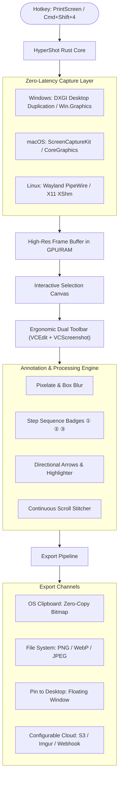

# ⚡ HyperShot

<div align="center">

**The Blazing-Fast, Cross-Platform Screenshot & Annotation Powerhouse.**  
*Combines the ergonomic sub-50ms speed of Lightshot, the rich annotation toolkit of Flameshot, and seamless Full-Page Scrolling Capture.*

[](LICENSE-MIT)
[](https://www.rust-lang.org/)
[]()
[]()

[English](#english) • [Português](#português) • [Architecture](#architecture) • [Roadmap](#roadmap)

</div>

---

<a name="english"></a>
## 🌟 Why HyperShot?

For years, developers, designers, and power users have been caught between two screenshot tools:
1. **Lightshot**: Instantaneous trigger (< 50ms) and intuitive dual-toolbar selection, but lacks vital privacy tools (no blur/pixelate), has no step numbering, and relies on insecure public links.
2. **Flameshot**: Powerful annotations (pixelate, sequential counter, desktop pinning), but heavy cold-start footprint on Windows (~100MB+ Qt runtime) and no scrolling capture.

**HyperShot solves this once and for all:**
* 🚀 **Zero-GC Pure Rust Engine**: Native GPU frame capture (DirectX 11 DXGI on Windows, ScreenCaptureKit on macOS, PipeWire/X11 on Linux) with sub-15ms trigger latency.
* 📜 **Full-Page Scrolling Capture**: Automatically captures and stitches long documents, web pages, and chats without requiring browser extensions.
* 🛡️ **Privacy by Design**: One-click **Pixelate** and **Gaussian Blur** to instantly redact passwords, tokens, API keys, and private data.
* 🔢 **Auto-Step Counter**: Click-to-add sequential step badges (`①`, `②`, `③`) for bug reports and tutorials.
* 📌 **Pin to Desktop**: Keep critical references floating seamlessly above your workspace.
* 📋 **Zero-Copy Clipboard**: Instant paste into WhatsApp, Slack, Teams, Discord, or Notion.

---

## 📊 Feature Comparison Matrix

| Feature | Lightshot ⚡ | Flameshot 🎨 | **HyperShot** 🚀 |
| :--- | :---: | :---: | :---: |
| **Engine / Architecture** | Delphi / Win32 | C++ / Qt6 | **Rust (Zero-GC, Native GPU)** |
| **Trigger Latency** | ~20 ms | ~250 - 400 ms | **< 15 ms (DirectX / Metal / Wayland)** |
| **Memory Footprint** | ~30 MB | ~110 MB | **~18 - 25 MB** |
| **Selection Toolbars** | Floating L-Dock (Right & Bottom) | Radial / Custom Bar | **Ergonomic L-Dock (Lightshot-style)** |
| **Pixelate & Blur (Redaction)** | ❌ None | ✅ Blur & Pixelate | ✅ **Multi-level Mosaic & Blur** |
| **Step Sequence Counter** | ❌ None | ✅ Step Circles | ✅ **Auto-increment Badges (`① ② ③`)** |
| **Full-Page Scroll Capture** | ❌ None | ❌ None | ✅ **Continuous NCC Stitching** |
| **Pin to Desktop (Always-on-Top)**| ❌ None | ✅ Yes | ✅ **Frameless Floating Canvas** |
| **Color Picker & Magnifier** | Basic | Advanced | ✅ **8x Loupe with HEX / RGB copy** |
| **Platforms** | Windows, macOS (legacy) | Linux, Windows, macOS | ✅ **Windows, macOS, Linux** |
| **Open Source License** | ❌ Proprietary | GPLv3 | ✅ **Dual MIT / Apache-2.0** |

---

<a name="architecture"></a>
## 🏗️ Architecture



---

<a name="português"></a>
## 🇧🇷 Português

O **HyperShot** é uma ferramenta de captura de tela de código aberto desenvolvida em Rust, combinando o melhor do **Lightshot** e do **Flameshot** com recursos inovadores como a **captura de tela com rolagem (página inteira)**.

### Destaques
1. **Acionamento Instantâneo**: Dispara em menos de 15 milissegundos via DirectX 11 / Metal / PipeWire.
2. **Barras Ergonômicas em L**: Duas barras coladas na borda da seleção (ferramentas de desenho à direita, ações na parte inferior).
3. **Censura de Dados**: Ferramentas de **Pixelate** e **Blur** para ocultar senhas e dados confidenciais antes de compartilhar.
4. **Passos Sequenciais**: Numeração automática (`①`, `②`, `③`) a cada clique.
5. **Captura com Rolagem**: Costura contínua de páginas longas sem necessidade de extensão de navegador.

---

## 🚀 Quick Start

### Build from source

```bash
# Clone the repository
git clone https://github.com/danielcustodio/hypershot.git
cd hypershot

# Run unit tests
cargo test

# Launch HyperShot
cargo run
```

---

## 🗺️ Roadmap

- [x] High-speed multi-monitor screen capture (DXGI / ScreenCaptureKit / PipeWire / X11).
- [x] Privacy filter pipelines (Mosaic Pixelate and Box Blur).
- [x] Step counter sequence badges (`①`, `②`, `③`).
- [x] Directional arrows, rectangles, and translucent highlighters.
- [x] Full-page continuous scroll stitcher engine (NCC matching).
- [x] Zero-copy OS clipboard export.
- [x] Interactive fullscreen overlay with 8-point resize handles and dimension badge.
- [x] Lightshot-style ergonomic Dual Dock toolbars (Right drawing bar & Bottom action bar).
- [x] Precision 8x Loupe magnifier with real-time HEX/RGB color picker.
- [x] Frameless floating "Pin to Desktop" (Always-on-Top reference window).
- [ ] System tray daemon with global hotkeys (`PrintScreen` / `Ctrl+Shift+X`).
- [ ] Pluggable cloud storage backend (S3, Cloudflare R2, Imgur, custom webhook).

---

## 📄 License

HyperShot is distributed under the terms of both the **MIT License** and the **Apache License (Version 2.0)**. See [LICENSE-MIT](LICENSE-MIT) and [LICENSE-APACHE](LICENSE-APACHE) for details.
